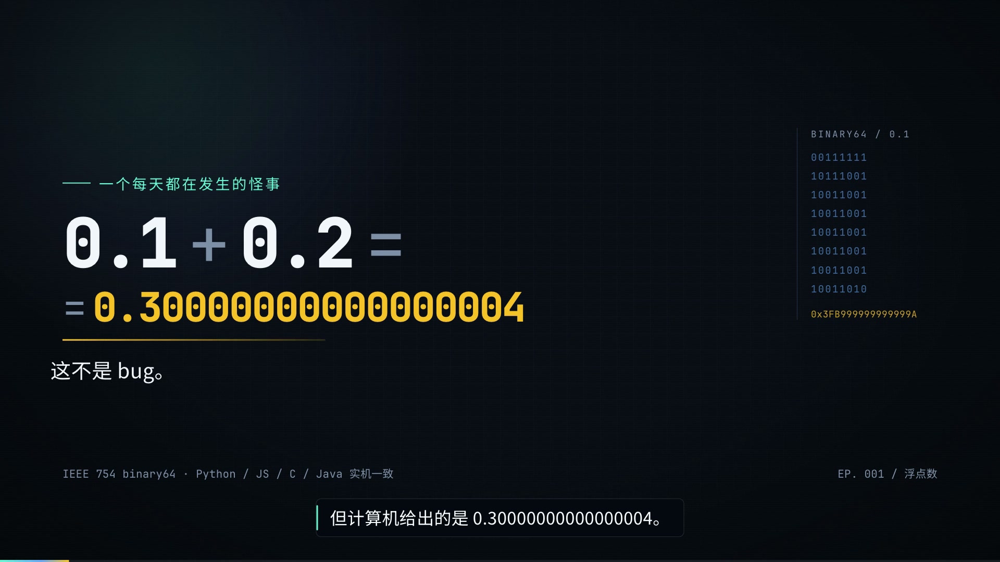

# 科普视频 skill

一个面向 AI agent 的制片的流程：从选题开始，做成一支横版或竖版的科普视频。所有画面由 HTML/CSS/GSAP 渲染，工程可复现、可继续改。



## 如何使用

对支持 skill 的 AI 工具说：

> 用 pop-science-video，把“为什么 0.1 + 0.2 不等于 0.3”做成一支 90 秒中文横版科普片。先给我看事实、叙事角度和镜头表，确认后再配音和渲染。

也可以直接把仓库地址发给它：

> 帮我安装这个 skill：https://github.com/xfq/pop-science-video ，然后用它做一支讲清 TCP 三次握手的科普片，面向没有计算机背景的受众。

安装、验证、首次做片、更新/卸载和排错见 [INSTALL.md](INSTALL.md)。发布到 GitHub 后也可以用 `npx skills add <repo> --skill pop-science-video`。

## 旁白

旁白换成真人的流程：

```sh
python3 <SKILL>/scripts/make_recording_kit.py --project <FILM>
# 按 recording/NARRATION.md 逐句录，放进 recording/takes/
python3 <SKILL>/scripts/import_recordings.py --project <FILM>
python3 <SKILL>/scripts/make_timeline.py --project <FILM>
python3 <SKILL>/scripts/mix_audio.py --project <FILM>
```

`make_recording_kit.py` 会把台词拆成逐句稿（文件名、目标时长、读法、字幕），`import_recordings.py` 负责去静音、高通、峰值归一、量时长，并重建 manifest。时间轴会按你的真实语速重排，不需要手动改字幕时间。

还没有录音、又想先去掉机器音：`python3 <SKILL>/scripts/mix_audio.py --project <FILM> --mute-voice` 可以出“音乐 + 字幕”的预览版；它不是正式片，等录音到位再混。

录音设备、房间、表演、降噪边界和验收清单见 [真人旁白](references/human-voice.md)。如果暂时不能录，`audition_voices.py` 可以试听本机其他中文音色。

外部 TTS（ElevenLabs/Azure/HeyGen）也可以逐句导出后走同一个导入流程。

## 改台词

台词在 `film.json` 每个镜头的 `narration[]` 里：`caption` 是屏幕字幕，`tts` 是配音读法。改完一条命令：

```sh
python3 <SKILL>/scripts/revise.py --project <FILM>
```

它先跑内容检查，只重录文本变了的句子，重排时间轴，时长变了才重做配乐，重新混音和构建。只改字幕、不动读音时不会重录。加 `--render draft` 或 `--render delivery` 会先跑 `hyperframes check`；正式片渲染后还会跑交付检查。报告在 `evidence/revise.json`。

## 十种镜头

模板自带 10 种可组合的镜头，全部由 `film.json` 驱动：

| 镜头 | 用来讲什么 | 例子 |
| --- | --- | --- |
| `hook` | 反直觉的开场冲突 | 0.1 + 0.2 = 0.30000000000000004 |
| `statement` | 一句结论/纠正 | “不是 bug。是二进制。” |
| `pipeline` | 3–6 步的因果/流程 | 十进制 → 二进制 → 53 位 → 相加 |
| `bitfield` | 位宽/编码 | 1 符号 + 11 指数 + 52 尾数 |
| `code` | 真实验证 | 终端里的 `False` / `True` |
| `compare` | 对照/误区 | 数学的 0.3 vs 存储的 0.3 |
| `numbers` | 尺度/误差 | 53 位、≈16 位十进制、1 ulp |
| `layers` | 层次/权衡 | 寄存器 → L1 → L2 → 内存 |
| `recap` | 三条可执行规则 | isclose / 整数分 / Decimal |
| `outro` | 留问题/下期 | “0.1 在内存里到底长什么样？” |

字段和用法见 [视觉语法](references/visual-grammar.md)。新增镜头类型只需改 `assets/template/lib/scenes.mjs`，再补文档和快照测试。

## 默认值

| 项 | 默认 |
| --- | --- |
| 画幅 / 帧率 | 1920×1080 / 30fps |
| 时长 | 90 秒（示例 100.5 秒） |
| 语言 | 中文；英文术语首次出现给中文解释 |
| 视觉 | 深蓝黑“实验室”：青=机制、琥珀=结果、珊瑚=错误 |
| 字体 | Noto Sans SC / Space Grotesk / JetBrains Mono（OFL） |
| 旁白 | 真人优先；3.5–5.5 字/秒；备选 edge / macOS say |
| 声音 | 原创配乐 + 8 个原创音效；−16 LUFS |
| 渲染 | HyperFrames，本地 Chrome + FFmpeg |

## 示例：0.1 + 0.2

| | |
| --- | --- |
| 成片 | [final.mp4](examples/float-0-1-0-2/renders/final.mp4)（100.5s） |
| 工程 | [examples/float-0-1-0-2](examples/float-0-1-0-2/) |
| 方向 | [DIRECTION.md](examples/float-0-1-0-2/DIRECTION.md) |
| 来源 | [SOURCES.md](examples/float-0-1-0-2/SOURCES.md) / [facts.json](examples/float-0-1-0-2/facts.json) |
| 台词 | [SCRIPT.md](examples/float-0-1-0-2/SCRIPT.md) |
| 复盘 | [case-float.md](references/case-float.md) |

## 环境

| 依赖 | 用途 |
| --- | --- |
| Node.js ≥ 22 | `build.mjs`、HyperFrames CLI |
| FFmpeg / ffprobe | 音频处理、编码、交付检查 |
| Chrome | HyperFrames 逐帧渲染 |
| Python ≥ 3.9 + numpy | 时间轴、音乐、混音、检查 |
| edge-tts（可选） | 在线中文配音；失败会自动回退 macOS `say` |
| macOS `say`（可选） | 本地中文草稿音色 |
| 真人录音（推荐） | 正式片旁白 |

```bash
python3 -m pip install -r requirements.txt
```

首次运行 `npx --yes hyperframes@0.8.184` 会下载 CLI；离线时先 `npm i -g hyperframes@0.8.184`。环境检查：

```sh
python3 scripts/check_environment.py --project <FILM>
```

它只报告缺项，不自动安装系统软件。

## 目录

```text
SKILL.md                    工作流、硬约束、工具入口
INSTALL.md                  安装、验证、首次做片、更新/卸载、排错
install.sh                  一键复制/链接到 skills 目录
references/                 选题、事实、叙事、视觉、台词、声音、制作、审片、案例
assets/template/            可运行模板：build.mjs、10 种镜头、字体、GSAP、音效
scripts/                    init / check / tts / timeline / music / mix / revise / delivery
examples/float-0-1-0-2/     完整示例工程、成片、来源、证据
tests/                      脚本与构建回归
agents/                     Codex 展示信息
```

## 质量边界

- 自动检查能发现结构、文件、时间轴、响度、对比度和首帧问题；**不能**证明事实正确、观众听懂、声音好听。
- TTS 是草稿/无录音条件的方案；正式片优先真人，并在交付里注明用了哪个 provider/voice。
- 模板为横版 1920×1080 编写；竖版需要重排，不是裁切。
- 事实、数字、代码输出会随版本变化；每支片重新做台账，不要复用示例的 claim。
- 示例中的 0.1 + 0.2 事实已实机核验；这不代表示例里每一句都适用于所有语言/版本，`facts.json` 的 `caveat` 写了边界。

## 许可与致谢

- 本项目的代码、文档、模板和原创音效：MIT（见 [LICENSE](LICENSE)）。
- 字体：SIL Open Font License 1.1（Noto Sans SC、Space Grotesk、JetBrains Mono）。
- GSAP：GreenSock 标准许可（随模板本地分发，见 [THIRD_PARTY.md](THIRD_PARTY.md)）。
- HyperFrames 是第三方渲染工具，按其自身许可使用。
- 方法上参考了 [op7418/guizang-product-video-skill](https://github.com/op7418/guizang-product-video-skill) 的工程化制片思路；本项目的代码、模板、脚本和音频均为独立实现，未复制其 AGPL 代码或素材。
